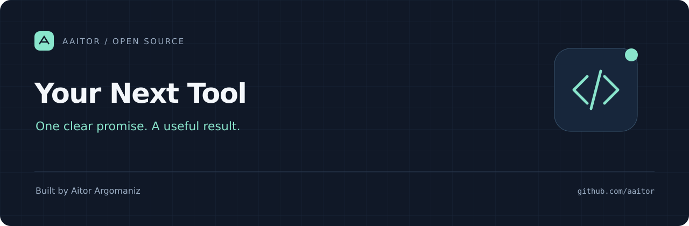

<p align="center">
  
</p>

<h1 align="center">Open Source Toolkit</h1>
<p align="center">A thoughtful home for the tools you build.</p>
<p align="center">
  <a href="#quick-start">Get started</a> ·
  <a href="docs/readme-guide.md">README guide</a> ·
  <a href="docs/showcase.md">Design references</a> ·
  <a href="docs/launch-checklist.md">Launch checklist</a>
</p>
<p align="center">
  <a href="LICENSE"></a>
  <a href="https://github.com/aaitor/oss-repo-template/actions/workflows/quality.yml"></a>
</p>

Publish personal tools with a recognizable identity, clear onboarding, and the community files people expect. This is a **GitHub template**, with no application framework or runtime imposed on the projects you create.

## Preview



One visual family, a distinct name and promise for each project. The editable SVG headers work on light and dark GitHub pages. Keep your actual product demo separate from this artwork.

## Quick start

**Prerequisites:** Git, Python 3.10+, and optionally the authenticated [GitHub CLI](https://cli.github.com/).

Click **[Use this template](https://github.com/aaitor/oss-repo-template/generate)**, create your repository, and clone it. Or use:

```bash
gh repo create aaitor/my-tool --template aaitor/oss-repo-template --public --clone
cd my-tool
python3 scripts/customize.py --repo my-tool --title "My Tool" \
  --tagline "Describe the useful outcome in one sentence."
python3 scripts/check.py
```

The setup command replaces this README with the [project README starter](templates/README.md), updates repository links and community contacts, and creates your branded SVG assets. Review the resulting files before committing:

```bash
git add .
git commit -m "Customize project identity and documentation"
git push
```

Then add your code, real installation commands, a working example, and a product screenshot or recording. Follow the [launch checklist](docs/launch-checklist.md). Setup writes local files only; it does not change GitHub settings or push commits.

## What's included

| Part | What you get |
| --- | --- |
| Identity | Editable navy-and-mint hero, example header, social card, and [brand guide](docs/branding.md) |
| Onboarding | [README starter](templates/README.md), [recommended structure](docs/readme-guide.md), and examples guidance |
| Community | Contributing guide, code of conduct, private security contact, bug and feature forms, PR template |
| Maintenance | Changelog, release-note categories, editor settings, and dependency updates for Actions |
| Quality | Read-only CI checks local documentation links, SVG validity, and setup behavior |
| Licensing | MIT license and a practical [MIT vs Apache-2.0 comparison](docs/licensing.md) |

## Repository layout

```text
.github/              Issue forms, PR template, release notes, and quality workflow
assets/               Editable hero artwork and social-preview assets
docs/                 README, branding, licensing, launch, and design guides
examples/             Guidance for complete, runnable project examples
scripts/              Local setup and repository checks; Python standard library
templates/README.md   README starter for your next project
CONTRIBUTING.md       How to contribute
CODE_OF_CONDUCT.md    Community expectations and reporting
SECURITY.md           Private vulnerability reporting
CHANGELOG.md          Human-readable release history
LICENSE               MIT
```

Add `src/` and `tests/` when your project needs them; retain the native layout of a skill, library, CLI, or application.

## Configuration

```bash
python3 scripts/customize.py --help
```

For your own projects the defaults are `aaitor`, Aitor Argomaniz, and the public contact in his GitHub profile. Other maintainers should pass `--owner`, `--author`, and `--contact`. Personalization refuses to overwrite a customized project unless `--force` is supplied. No API keys or environment variables are needed.

## Documentation

- [Write a README people can use](docs/readme-guide.md)
- [Branding and social previews](docs/branding.md)
- [Repositories worth studying](docs/showcase.md)
- [Choose a permissive license](docs/licensing.md)
- [Prepare a repository for publication](docs/launch-checklist.md)

## Contributing and support

Small improvements and corrections are welcome. Start with [CONTRIBUTING.md](CONTRIBUTING.md), follow the [code of conduct](CODE_OF_CONDUCT.md), and use the repository's **Issues** tab for questions or bug reports. Report vulnerabilities privately using [SECURITY.md](SECURITY.md).

## License

[MIT](LICENSE) © 2026 Aitor Argomaniz. You may use, fork, modify, sell, and redistribute this template, including in proprietary projects, while preserving its copyright and license notice.

---

Built by [Aitor Argomaniz](https://github.com/aaitor) · [LinkedIn](https://www.linkedin.com/in/aitorargomaniz) · [More open source](https://github.com/aaitor?tab=repositories)
